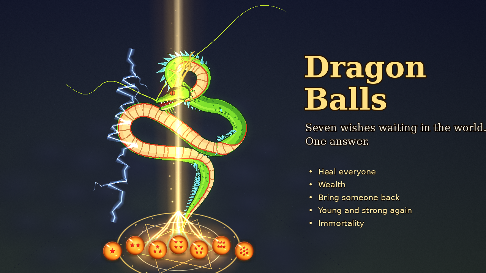

# Dragon Balls

Seven glass Dragon Balls are hidden in the world's affairs. Gather all seven, call Shenron, and make one wish.

For RimWorld 1.6 and 1.7. Requires [Harmony](https://github.com/pardeike/HarmonyRimWorld/releases/latest).

## Install

1. Install Harmony.
2. Download the latest `DragonBalls_vX.Y.Z.zip` from [Releases](../../releases).
3. Unzip it into RimWorld's `Mods` folder, so you have `Mods/DragonBalls/About/About.xml`.
4. Enable **Harmony**, then **Dragon Balls**.

## How to play

### 1. Find the balls
There is only ever **one of each ball** (one to seven red stars). They are light (0.2) and can be picked up, hauled and carried by caravan.

- **Lying on a map.** Quest-site and caravan-encounter maps sometimes have one (5% by default). You are told only when a colonist gets within 7 cells: a letter, "Something glints". Leave without it and it goes back into hiding.
- **In a faction's base.** Factions get hold of free balls and keep them in their bases, on a pedestal under guard. Enter the base, beat the guards and take it. The more balls a faction holds, the harder its guards.
- **On the move.** Factions carry balls between bases in heavily guarded convoys that travel for days. A caravan of yours can ambush a hostile one.

### 2. Track them
- Research **Dragon radar**, then craft a radar (machining table). While you own one it sweeps the world and marks where factions keep balls on the world map. It sometimes shows a false signal, which fades, or ends when you reach the base.
- Research **Dragon radar precision** to see the exact base instead of just the faction.
- Research **Dragon ball encyclopedia** for the Encyclopedia button on the bottom bar: an open storybook with one page per ball, showing who keeps it and who carries it. It needs a radar to show anything.

### 3. Get them
- **Take them** from bases and ambushed convoys.
- **Negotiate.** Friendly factions never offer a ball. Open the Encyclopedia, pick a ball a friendly faction holds, press **Negotiate**. A ball costs **100,000 silver**, or a **favour**: an enemy of theirs raids you and every raider must die. They only talk to a trusted friend with a rich colony.
- **Sell.** A faction pays 10,000 silver for a ball.

### 4. Keep them
- Hostile factions that hear you hold a ball send thieves, or a full war party. Raiders within 30 cells of a ball on the ground leave the raid and go straight for it. If thieves leave the map with it, their faction keeps it.
- Factions also fight each other over balls. A war is announced three days ahead, and you can send silver to a side.

### 5. Summon Shenron
1. Lay all seven balls on the ground within **9 cells** of each other.
2. Select any ball and press **Summon Shenron** (greyed out, with the reason, until all seven are near).
3. Confirm. The balls rise into a hexagon, the sky goes black, and Shenron appears: "Now, state your wish."

### 6. Make one wish
One wish per summon, or send him away and nothing is lost.

| Wish | Result |
| --- | --- |
| Heal everyone | Every colonist, slave, prisoner and animal of yours is healed in full |
| Wealth | 20,000 silver falls from the sky |
| Bring someone back | A dead colonist rises, whole and well (once per colonist) |
| Young and strong again | A colonist becomes about 21 again, cured of age conditions, and is faster for a year |
| Immortality | A colonist never ages and cannot die. A killing blow is undone: a phoenix rebuilds the body over six hours, then you choose where they rise. Once per save |
| Teach us | Two skills go to 20 |
| Rain of plenty | 15 days of rich soil |
| A new friend | faction reputation ups  |

### 7. Afterwards
The balls turn to stone where they lay. After about 15 days the stones crumble and the balls scatter again, free to turn up anywhere.

## The danger from other factions
If one faction ends up holding all seven balls, a five-day countdown starts, and it calls the dragon itself. A hostile faction may wish for an unrecruitable armoured giant with a big escort, a plague on your colonists, or something silly. A friendly one may share its wealth or wish something silly. The balls go back into hiding afterwards.

## Settings
Options > Mod settings > Dragon Balls. You can switch effects on or off, hide the immortal's aura (the golden halo stays), and change the chance a map has a ball, how often factions take one, the days until the stones scatter, faction deals, raids and wishes, Shenron's size, and the wealth wish.

*Unofficial fan work. Not affiliated with Akira Toriyama, Toei Animation or Shueisha.*
